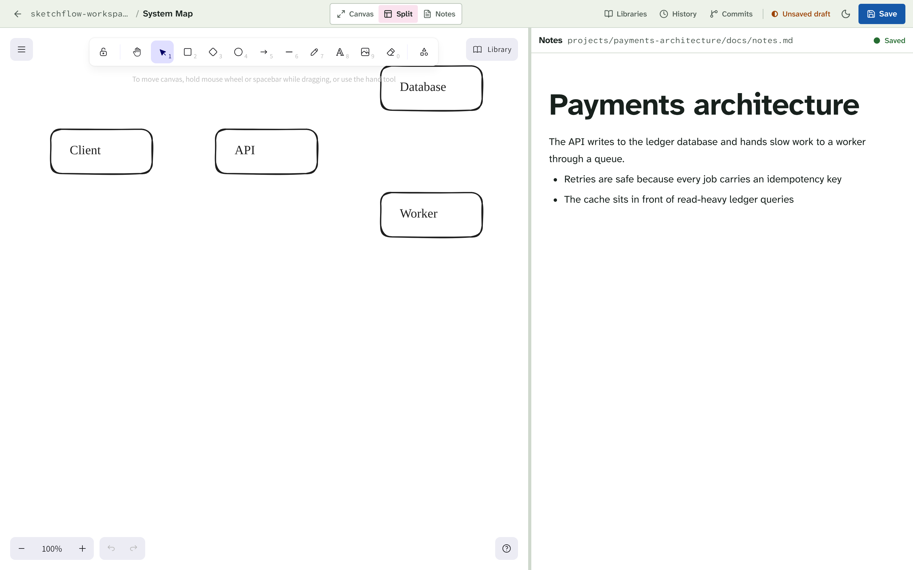
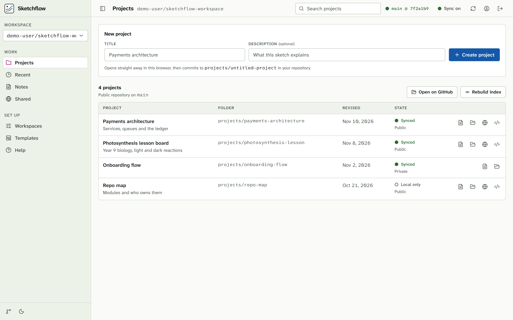
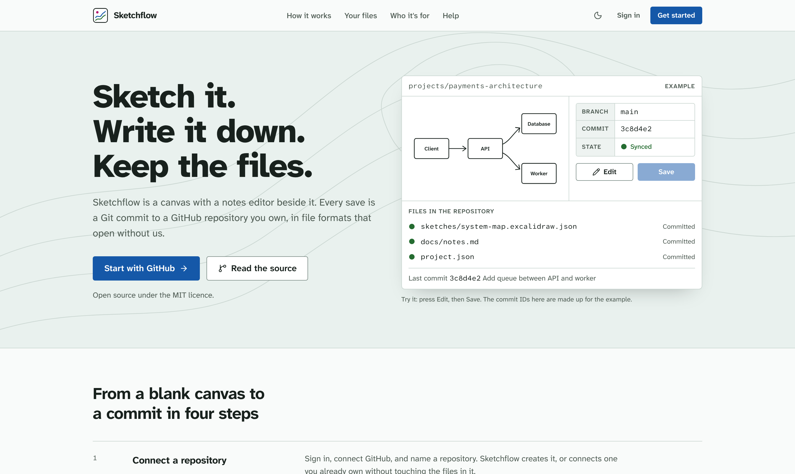
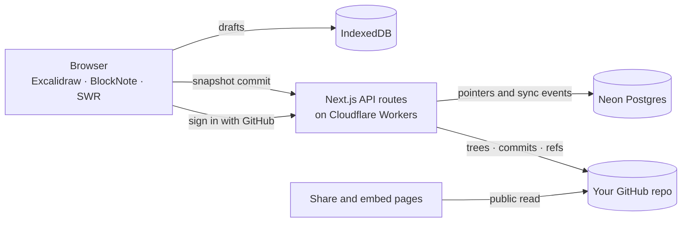

<div align="center">

# Sketchflow

**A visual workspace that saves to a GitHub repo you own.**

Draw on an Excalidraw canvas, write notes beside it, and commit both as plain files.

[](https://github.com/playlikeboy/sketchflow/actions/workflows/verify.yml)
[](./LICENSE)
[](https://github.com/playlikeboy/sketchflow/stargazers)

[Live app](https://sketchflow.space) · [Architecture](./docs/ARCHITECTURE.md) · [Self-hosting](./docs/SELF_HOSTING.md) · [Changelog](./CHANGELOG.md) · [Contributing](./CONTRIBUTING.md) · [Security](./SECURITY.md)



</div>

<p align="center">
  
  
</p>

<sub>Screenshots use example data.</sub>

## Why

Most whiteboard tools keep your diagrams in their database. Sketchflow keeps them in yours: every sketch is a standard `.excalidraw.json` file and every note is a Markdown file, committed to a repository in your GitHub account. If Sketchflow disappeared tomorrow, your work would still open in Excalidraw and any text editor, with full Git history.

## What it does

- **Canvas and notes side by side.** An Excalidraw canvas next to a BlockNote editor, per project.
- **Try it without an account.** `/try` opens a real editor that saves only in the browser; sign in later and import the sketch as a project.
- **Local first.** Edits are written to IndexedDB as you work, so the editor does not wait on the network. Drafts are scoped per signed-in user.
- **Snapshot commits.** A save writes the sketch, notes and project metadata in one Git commit through the GitHub Git Data API. Nothing is committed per stroke.
- **Conflict handling.** A save is refused if the branch moved since your draft was based on it, and you choose which version becomes the latest. Nothing is overwritten silently.
- **Project history and restore.** List the commits that touched a project, preview an old version, and restore it as a new commit.
- **Public share and embed pages.** Read-only pages for projects in public repositories, which respect the `sharing` setting in each project's `project.json`.
- **Fork a public project** into your own workspace.
- **Excalidraw libraries.** Browse and install community shape libraries.
- **Installable.** Ships a web manifest and service worker.

## How it works



Three stores, each with one job:

| Store | Holds | Why |
| --- | --- | --- |
| Your GitHub repo | Sketches, notes, project metadata, exports | The durable source of truth, owned by you |
| IndexedDB | Unsaved drafts and offline caches | Instant edits and offline work |
| Postgres | Users, workspace pointers, sync events | Small on purpose; no sketch content is stored here |

A workspace repository looks like this:

```text
your-workspace-repo/
├── .sketchflow/
│   ├── workspace.json
│   └── manifest.json
└── projects/
    ├── projects-metadata.json
    └── <project>/
        ├── project.json
        ├── sketches/<sketch>.excalidraw.json
        ├── docs/notes.md
        ├── exports/
        └── assets/
```

More detail is in the [architecture guide](./docs/ARCHITECTURE.md).

## Tech stack

Next.js 16 (App Router) and React 19, deployed to Cloudflare Workers with OpenNext. Better Auth for GitHub sign-in, with the session kept in encrypted cookies. Neon Postgres through Drizzle. Tailwind CSS 4. Bun for installs, scripts and tests.

The interface follows the Survey Sheet design system documented in [DESIGN.md](./DESIGN.md), with product context in [PRODUCT.md](./PRODUCT.md).

## Run it locally

You need [Bun](https://bun.sh), a [GitHub OAuth App](https://github.com/settings/developers), and a [Neon](https://neon.tech) database.

Set the OAuth App's authorization callback URL to `http://localhost:3000/api/auth/callback/github`. A GitHub OAuth App has a single callback URL, so use one app for local development and another for each deployed origin.

```bash
git clone https://github.com/playlikeboy/sketchflow.git
cd sketchflow
bun install
cp .env.example .env.local
```

Fill in `.env.local`:

| Variable | Purpose |
| --- | --- |
| `BETTER_AUTH_SECRET` | Random secret that encrypts the session cookies (`openssl rand -base64 32`) |
| `BETTER_AUTH_URL` | Public origin of a deployment. Leave unset in development |
| `GITHUB_CLIENT_ID` | GitHub OAuth App client id |
| `GITHUB_CLIENT_SECRET` | GitHub OAuth App client secret |
| `DATABASE_URL` | Neon Postgres connection string |
| `NEXT_PUBLIC_APP_URL` | Base URL, `http://localhost:3000` in development |
| `GITHUB_API_VERSION` | GitHub REST API version, default `2022-11-28` |
| `GITHUB_OAUTH_SCOPES` | Scopes requested from GitHub, default `repo,read:user,user:email` |
| `SKETCHFLOW_REPO_NAME` | Default name for a new workspace repository |
| `SKETCHFLOW_DEFAULT_BRANCH` | Fallback branch name, default `main` |

Then create the tables and start the app:

```bash
bun run db:push
bun run dev
```

## Scripts

| Command | What it does |
| --- | --- |
| `bun run dev` | Development server |
| `bun run test` | Unit and API handler tests |
| `bun run test:e2e` | Browser tests against a production build, with fixture API data |
| `bun run lint` | ESLint |
| `bun run typecheck` | TypeScript, no emit |
| `bun run build` | Production build |
| `node scripts/smoke.mjs <url>` | HTTP smoke test against a running build |
| `bun run db:push` | Push the Drizzle schema to the database |
| `bun run deploy` | Build with OpenNext and deploy to Cloudflare |

CI runs the tests, lint, typecheck, build, the smoke test and the browser tests on every pull request.

## Security model

- Signing in with GitHub grants repository access once, on GitHub's consent screen. Sketchflow keeps the resulting token only in an encrypted, HttpOnly cookie in the user's browser; it is never written to Postgres, logs or repository files. A user can instead supply a personal access token that stays in their own browser session.
- Sessions are stateless and last 30 days. Signing out clears the cookies; to cut off a session Sketchflow cannot reach, revoke the app under GitHub's authorized OAuth apps, or rotate `BETTER_AUTH_SECRET` to end every session.
- Every write route checks that the workspace belongs to the signed-in user, rejects cross-site requests, validates each path segment and branch name, and is rate limited per user.
- Content read from a repository is treated as untrusted input, including the user's own.
- Connecting an existing repository never overwrites files already in it.
- App pages cannot be framed; only `/embed` pages can.

See [SECURITY.md](./SECURITY.md) for how to report a vulnerability.

## Status

Sketchflow is a working app under active development. Known gaps, tracked in [`plans/06-improvement-master-prompt.md`](./plans/06-improvement-master-prompt.md):

- The Content-Security-Policy ships in report-only mode until it has been exercised in production.
- Rate limiting is in memory per Worker isolate; a durable limiter is planned.
- Browser tests run against fixture data. Nothing in CI exercises a real GitHub account or database.
- A conflicting save offers a choice of version, not a merge view.

## Contributing

Issues and pull requests are welcome. Read [CONTRIBUTING.md](./CONTRIBUTING.md) and the [Code of Conduct](./CODE_OF_CONDUCT.md) first, and run the checks above before opening a pull request.

## License

[MIT](./LICENSE) © 2025-2026 [Shaswat Raj](https://github.com/playlikeboy) and Sketchflow contributors.
