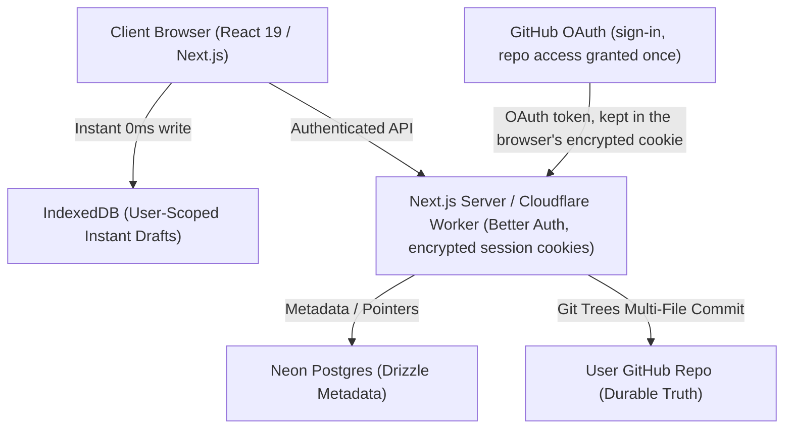

# Sketchflow Architecture

This document provides a technical deep dive into Sketchflow's architecture, data model, offline-first sync engine, and design principles.

---

## 🏛️ Core Philosophy

```
┌─────────────────────────────────────────────────────────┐
│                      SKETCHFLOW                         │
│  "GitHub owns durable data. Sketchflow owns fast UX."   │
└─────────────────────────────────────────────────────────┘
```

Traditional visual collaboration apps lock user drawings and notes inside a proprietary database. Sketchflow reverses this model:
1. **Durable Storage**: All sketch scenes, markdown notes, exports, and assets live as standard files in the user's own GitHub repository.
2. **Instant Interaction**: Every keystroke and brush stroke writes directly to browser IndexedDB with zero network latency (0ms).
3. **Optimistic Git Sync**: Durable saves snapshot the current state and commit atomically to GitHub via the REST Git Data (Trees/Commits/Refs) API.
4. **Minimal Metadata Database**: Postgres only tracks users, workspace-repo mappings, sync status, and billing flags. No private sketch content ever touches Postgres.

---

## 🧩 System Architecture



---

## 🗄️ Repository File Structure

Every workspace repository connected to Sketchflow is structured cleanly:

```
my-sketchflow-workspace/
├── .sketchflow/
│   ├── manifest.json              # Workspace manifest & schema version
│   ├── workspace.json             # Workspace settings
│   └── indexes/
│       ├── public-projects.json   # Public sharing pointers
│       └── search-index.json      # Fast search cache
└── projects/
    ├── projects-metadata.json     # Ordered project registry & tags
    └── {project-slug}/
        ├── project.json           # Project metadata & sketch pointers
        ├── sketches/
        │   └── {sketch-slug}.excalidraw.json   # Excalidraw scene JSON
        ├── docs/
        │   └── notes.md           # BlockNote markdown documentation
        ├── exports/               # Exported PNG/SVG assets
        └── assets/                # User uploaded images (<2MB)
```

---

## ⚡ Offline-First & Storage Layer

### 1. User & Workspace Scoped IndexedDB
To prevent cross-user draft leaks on shared devices or multiple accounts, all local storage keys are partitioned by the Sketchflow user id (named `stackUserId` in code and `stack_user_id` in Postgres for historical reasons; it is derived from the GitHub account, see `src/server/identity.ts`):
- Sketches: `local-sketch:${userId}:${workspaceId}:${projectId}:${sketchId}`
- Documentation: `local-notes:${userId}:${workspaceId}:${projectId}`
- Layout & Editor State: `local-state:${userId}:${workspaceId}:${projectId}:${sketchId}`
- Workspace Metadata Cache: `projects-cache:${userId}:${workspaceId}`

### 2. Debounced Draft Engine
- Canvas updates and BlockNote doc edits debounce draft saves by 500ms into IndexedDB.
- A draft indicator in the top header transitions between `Draft` (unsaved local changes) and `Synced` (committed to remote GitHub HEAD).

### 3. Background Sync & Atomic Commits
Instead of full `git clone` or committing every individual file in serial HTTP requests, Sketchflow constructs a single Git tree object containing:
- Updated `.excalidraw.json`
- Updated `notes.md`
- Updated `project.json`
- Updated `projects-metadata.json`

This creates **one clean, atomic commit** with a descriptive commit message and author attribution.

---

## 🎨 Contrast & Theme Synchronization Engine

Excalidraw maintains separate internal state for canvas drawing colors and interface themes. In dark mode, Excalidraw defaults new drawing strokes to pure white (`#ffffff`).

Sketchflow includes an automatic contrast engine (`ensureVisibleStrokeColors`):
- **Dark Mode**: Canvas background is `#121212`. Any black or dark strokes (`#000000`, `#1e1e1e`) are dynamically normalized to `#ffffff`.
- **Light Mode**: Canvas background is `#ffffff`. Any white or faint strokes (`#ffffff`, `#f0f0f0`) are dynamically normalized to `#1e1e1e`.
- **Color Preservation**: Brand and highlight colors (blue, red, emerald, purple) remain untouched in both themes.
- **Dynamic Live Repaint**: Theme switches trigger `api.updateScene(...)` and `api.refresh()`, repainting active elements in memory without remounting the canvas or discarding undo history.

---

## 🚀 Deployment & Infrastructure

- **Edge Runtime**: Built with Next.js 16 and deployed to Cloudflare Workers via `@opennextjs/cloudflare`.
- **PWA Ready**: Web app manifest, service worker caching for static assets, and home screen installation support.
- **Database**: Hosted on Neon serverless Postgres with Drizzle ORM queries and connection pooling.
